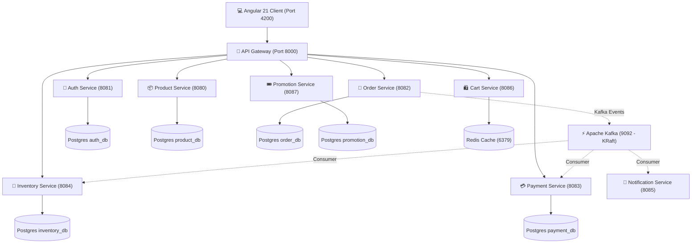

# 🛍️ NexusCommerce - Distributed E-Commerce Microservices Platform

A modern, high-scalability E-Commerce microservices ecosystem built with **Java 17**, **Spring Boot 3**, **Spring Cloud Gateway**, **Angular 21**, **PostgreSQL 17**, **Redis 7**, and **Apache Kafka 7.5 (KRaft Mode)**.

---

## 📋 Table of Contents
- [Architecture & Design Patterns](#-architecture--design-patterns)
- [Architectural Guiding Rules](#-architectural-guiding-rules)
- [Core Business & Technical Features](#-core-business--technical-features)
- [Microservices Specification](#-microservices-specification)
- [Project Directory Structure](#-project-directory-structure)
- [Event-Driven Workflows (Kafka)](#-event-driven-workflows-kafka)
- [System Output Expectations](#-system-output-expectations)
- [Prerequisites](#-prerequisites)
- [Installation & Setup](#-installation--setup)
- [Comprehensive Docker Deployment Guide](#-comprehensive-docker-deployment-guide)
- [Default Login Credentials](#-default-login-credentials)
- [API Usage & Examples](#-api-usage--examples)
- [Available Scripts & Commands](#-available-scripts--commands)
- [Running in Development Mode (Multi-Terminal)](#-running-in-development-mode-multi-terminal)
- [Testing](#-testing)
- [Comprehensive Troubleshooting & FAQs](#-comprehensive-troubleshooting--faqs)
- [Contributing](#-contributing)
- [License](#-license)
- [Authors & Contact](#-authors--contact)

---

## 🏗️ Architecture & Design Patterns

The platform implements industry-standard cloud-native design patterns:
- **API Gateway Pattern**: Single entry point (`Spring Cloud Gateway`) handling routing, rate limiting, and JWT authentication forwarding.
- **Database-per-Service**: Each microservice manages its own isolated PostgreSQL database.
- **Event-Driven Architecture (EDA)**: Asynchronous inter-service communication via Apache Kafka topics.
- **Stateless Security**: Centralized JWT token verification and OAuth2 integration with Spring Security.
- **Cache-Aside Pattern**: Redis 7 caching for product catalog and shopping cart persistence.



---

## 📐 Architectural Guiding Rules

1. **Single Entry Point**: All external client requests must pass through `Spring Cloud Gateway` on port `8000`. No direct client access to downstream microservices is permitted.
2. **Database Isolation**: Microservices strictly access their own dedicated PostgreSQL database (`Database-per-Service`). Cross-database queries or foreign key joins between services are forbidden.
3. **Asynchronous Side Effects**: Non-blocking operations (stock reservation, payment confirmation, email dispatching) are driven entirely through **Apache Kafka** event topics to avoid cascading failures.
4. **Stateless Gateway Auth**: Gateway verifies JWT tokens and forwards claims (`X-User-Id`, `X-User-Role`) downstream via request headers, eliminating duplicate database lookup overhead.

---

## 💼 Core Business & Technical Features

| Feature | Category | Description |
|---------|----------|-------------|
| 🔐 **OAuth2 & JWT Security** | Security | Centralized authentication supporting Google Social Login and JWT token verification |
| 🛡 **RBAC & Header Forwarding** | Security | Role-Based Access Control (Admin/User) propagated seamlessly from Gateway to services |
| ⚡ **Event-Driven Processing** | Architecture | Asynchronous order placement, inventory reservation, and payment event streaming via Apache Kafka |
| 💳 **VNPay Integration** | Payment | Online checkout via VNPay Sandbox with IPN (Instant Payment Notification) callback handling |
| 🚀 **High-Speed Redis Cart** | Performance | In-memory shopping cart management with TTL persistence using Redis 7 |
| 🖼 **Cloudinary Media Upload** | Media | Product image upload and automated cloud media storage optimization |
| 🏢 **Stock Reservation** | Inventory | Real-time stock reservation and automatic rollback upon order payment failure |
| 📧 **Async Email Dispatch** | Notification | Background HTML order confirmation email notifications via JavaMail (SMTP) |
| 🎟 **Promotion Engine** | Sales | Voucher discount management and automatic order discount calculation |
| 🐳 **Zero-Config Docker Orchestration** | DevOps | Full multi-container cluster setup with Docker Compose (PostgreSQL, Redis, Kafka KRaft, Services) |

---

## 🎯 Microservices Specification

| Service | Port | Database / Storage | Tech Stack | Responsibilities |
|---------|------|-------------------|------------|------------------|
| **API Gateway** | `8000` | - | Spring Cloud Gateway | Entry point routing, CORS, Auth forwarding |
| **Auth Service** | `8081` | PostgreSQL (`auth_db`) | Spring Boot, OAuth2, JWT | User registration, authentication, RBAC |
| **Product Service** | `8080` | PostgreSQL (`product_db`) | Spring Boot, Cloudinary | Product catalog, categories, image uploads |
| **Order Service** | `8082` | PostgreSQL (`order_db`) | Spring Boot, FeignClient | Order creation, lifecycle management |
| **Payment Service** | `8083` | PostgreSQL (`payment_db`) | Spring Boot, VNPay API | VNPay Sandbox integration, IPN callbacks |
| **Inventory Service** | `8084` | PostgreSQL (`inventory_db`)| Spring Boot | Stock management, reservations |
| **Notification Service** | `8085` | - | Spring Boot, JavaMail | Asynchronous email dispatching |
| **Cart Service** | `8086` | Redis 7 | Spring Boot, Spring Data Redis | In-memory shopping cart operations |
| **Promotion Service** | `8087` | PostgreSQL (`promotion_db`)| Spring Boot | Discount codes & promotion campaigns |
| **Frontend** | `4200` | LocalStorage / RxJS | Angular 21, TypeScript 5.9 | User Interface & admin dashboard |

---

## 📁 Project Directory Structure

```
Ecommerce-Microservice/
├── api-gateway/                 # Spring Cloud Gateway (Port 8000)
│   ├── src/main/java/com/ecommerce/gateway/
│   ├── Dockerfile
│   └── pom.xml
├── auth_service/                # User Authentication & OAuth2/JWT (Port 8081)
│   ├── src/main/java/com/ecommerce/auth/
│   ├── Dockerfile
│   └── pom.xml
├── product_service/             # Product Catalog & Cloudinary (Port 8080)
│   ├── src/main/java/com/ecommerce/product/
│   ├── Dockerfile
│   └── pom.xml
├── order_service/               # Order Lifecycle Management (Port 8082)
│   ├── src/main/java/com/ecommerce/order/
│   ├── Dockerfile
│   └── pom.xml
├── payment_service/             # VNPay Integration Service (Port 8083)
│   ├── src/main/java/com/ecommerce/payment/
│   ├── Dockerfile
│   └── pom.xml
├── inventory_service/           # Inventory & Stock Reservation (Port 8084)
│   ├── src/main/java/com/ecommerce/inventory/
│   ├── Dockerfile
│   └── pom.xml
├── notification_service/        # Email Dispatching Service (Port 8085)
│   ├── src/main/java/com/ecommerce/notification/
│   ├── Dockerfile
│   └── pom.xml
├── cart_service/                # Redis Cart Service (Port 8086)
│   ├── src/main/java/com/ecommerce/cart/
│   ├── Dockerfile
│   └── pom.xml
├── promotion_service/           # Discount & Vouchers Service (Port 8087)
│   ├── src/main/java/com/ecommerce/promotion/
│   ├── Dockerfile
│   └── pom.xml
├── frontend_eco/                # Angular 21 Client Application (Port 4200)
│   ├── src/app/
│   ├── package.json
│   └── angular.json
├── docker-compose.yml           # Complete Container Orchestration Manifest
├── .env.example                 # Sample Environment Configuration Template
└── README.md                    # System Documentation
```

---

## 🔄 Event-Driven Workflows (Kafka)

Microservices communicate asynchronously using Apache Kafka topics:
1. `order-created-topic`: Triggered when a new order is placed. Consumed by **Inventory Service** (to reserve stock) and **Notification Service** (to send confirmation email).
2. `payment-completed-topic`: Triggered after successful VNPay payment callback. Consumed by **Order Service** (to update status to `PAID`).
3. `inventory-updated-topic`: Broadcasts stock changes across the cluster.

---

## 8. SYSTEM OUTPUT EXPECTATIONS

The APIs produce standardized JSON response envelopes across all services.

### API Success Response Format (`200 OK` / `201 Created`)
```json
{
  "status": 200,
  "message": "Operation successful",
  "data": {
    "id": 1,
    "email": "user@example.com",
    "token": "eyJhbGciOiJIUzI1NiJ9..."
  },
  "timestamp": "2026-09-15T16:00:00.000+00:00"
}
```

### API Error Response Format (`400 Bad Request` / `401 Unauthorized` / `500 Server Error`)
```json
{
  "status": 400,
  "error": "BAD_REQUEST",
  "message": "Invalid payment signature or parameters",
  "path": "/api/v1/payments/create",
  "timestamp": "2026-09-15T16:05:00.000+00:00"
}
```

### Log Output Format (Spring Boot Console & Docker Logs)
```text
2026-09-15 16:10:00.123 [main] INFO  c.e.auth.config.DataInitializer - Khởi tạo vai trò (roles) trong bảng roles...
2026-09-15 16:10:00.456 [main] INFO  c.e.auth.config.DataInitializer - Khởi tạo 3 tài khoản mẫu thành công!
```

---

## 9. PREREQUISITES

Ensure the following tools are installed on your machine:

| Component | Minimum Version Required | Checked File / Reference |
|-----------|-------------------------|--------------------------|
| **Java Development Kit (JDK)** | Java 17+ | `pom.xml` (`<java.version>17</java.version>`) |
| **Node.js** | v18.0.0+ | `frontend_eco/package.json` |
| **npm** | v10.8.2+ | `frontend_eco/package.json` (`packageManager`) |
| **Docker & Docker Desktop** | v24.0.0+ (Docker Compose v2.20+) | `docker-compose.yml` |
| **Git** | v2.40.0+ | `.gitignore` |

---

## 10. INSTALLATION & SETUP

Follow these step-by-step instructions to set up the project locally:

### Step 1: Clone Repository
```bash
git clone https://github.com/vongxoay2004/Ecommerce-Microservice.git
cd Ecommerce-Microservice
```

### Step 2: Configure Environment Variables
Copy `.env.example` to `.env` in the root directory:
```bash
cp .env.example .env
```

Review and update the variables in `.env`:
```env
# JWT Key
JWT_SECRET=404E635266556A586E3272357538782F413F4428472B4B6250645367566B5970

# Cloudinary Storage
CLOUDINARY_CLOUD_NAME=your-cloud-name
CLOUDINARY_API_KEY=your-api-key
CLOUDINARY_API_SECRET=your-api-secret

# VNPay Payment Gateway
VNPAY_TMN_CODE=your-tmn-code
VNPAY_HASH_SECRET=your-hash-secret
VNPAY_URL=https://sandbox.vnpayment.vn/paymentv2/vpcpay.html
VNPAY_RETURN_URL=http://localhost:4200/checkout/vnpay-callback

# Email Notification Credentials
MAIL_USERNAME=your-email@gmail.com
MAIL_PASSWORD=your-app-password
MAIL_FROM_NAME=Ecommerce Shop
```

### Step 3: Install Frontend Dependencies
```bash
cd frontend_eco
npm install
cd ..
```

---

## 🐳 Comprehensive Docker Deployment Guide

You can run the application using Docker in three different modes:

### Mode 1: Full-Stack Deployment (Recommended)
Builds and starts all 9 microservices and infrastructure containers (PostgreSQL, Redis, Kafka):

```bash
# Start all containers in detached mode
docker-compose up -d --build

# Verify container statuses
docker-compose ps
```

### Mode 2: Infrastructure-Only Mode (For Local IDE Development)
If you want to run Spring Boot services inside IntelliJ/VS Code and only run DB/Kafka/Redis in Docker:

```bash
# Start PostgreSQL, Redis, and Kafka only
docker-compose up -d postgres redis kafka

# Initialize required PostgreSQL databases
docker exec ecommerce-postgres psql -U postgres -c "CREATE DATABASE auth_db;"
docker exec ecommerce-postgres psql -U postgres -c "CREATE DATABASE product_db;"
docker exec ecommerce-postgres psql -U postgres -c "CREATE DATABASE order_db;"
docker exec ecommerce-postgres psql -U postgres -c "CREATE DATABASE payment_db;"
docker exec ecommerce-postgres psql -U postgres -c "CREATE DATABASE inventory_db;"
docker exec ecommerce-postgres psql -U postgres -c "CREATE DATABASE promotion_db;"
```

---

## 11. DEFAULT LOGIN CREDENTIALS

The `auth_service` automatically seeds initial test accounts into `auth_db` upon startup (defined in `DataInitializer.java`):

| Role | Email / Username | Password | Full Name | Phone | Notes |
|------|------------------|----------|-----------|-------|-------|
| **ADMIN** | `admin@example.com` | `Admin123@` | System Administrator | 0900000000 | System administrator access |
| **USER** | `john@example.com` | `User123@` | John Doe | 0901234567 | Test customer account 1 |
| **USER** | `jane@example.com` | `User123@` | Jane Smith | 0987654321 | Test customer account 2 |

> ⚠️ **Security Warning**: Do NOT use these default seeded credentials in a production environment. Change secret keys and passwords before deployment.

---

## 12. USAGE & API EXAMPLES

All requests should be sent via the **API Gateway** (`http://localhost:8000`).

### 1. Register a New User
```bash
curl -X POST http://localhost:8000/api/v1/auth/register \
  -H "Content-Type: application/json" \
  -d '{
    "email": "newuser@example.com",
    "password": "User123@",
    "fullName": "New Customer",
    "phone": "0912345678"
  }'
```

### 2. User Login
```bash
curl -X POST http://localhost:8000/api/v1/auth/login \
  -H "Content-Type: application/json" \
  -d '{
    "email": "admin@example.com",
    "password": "Admin123@"
  }'
```

### 3. Fetch Product Catalog
```bash
curl -X GET http://localhost:8000/api/v1/products \
  -H "Authorization: Bearer <YOUR_JWT_TOKEN>"
```

### 4. Create VNPay Payment URL
```bash
curl -X POST http://localhost:8000/api/v1/payments/create \
  -H "Authorization: Bearer <YOUR_JWT_TOKEN>" \
  -H "Content-Type: application/json" \
  -d '{
    "orderId": 1001,
    "amount": 29990000,
    "orderInfo": "Payment for order 1001"
  }'
```

---

## 13. AVAILABLE SCRIPTS & COMMANDS

### Frontend Scripts (`frontend_eco/package.json`)
| Command | Description |
|---------|-------------|
| `npm start` | Starts Angular development server at `http://localhost:4200` |
| `npm run build` | Compiles production assets into `dist/` directory |
| `npm run watch` | Watches for file changes and rebuilds development bundle |
| `npm test` | Runs unit tests using Vitest test runner |

### Docker & Infrastructure Management
| Command | Description |
|---------|-------------|
| `docker-compose up -d` | Boots up all services and infrastructure |
| `docker-compose down -v` | Stops and removes all containers and volume data |
| `docker-compose logs -f <service>` | Streams live logs for a specific service |
| `docker exec -it ecommerce-postgres psql -U postgres` | Connects to PostgreSQL CLI |

---

## 🖥️ Running in Development Mode (Multi-Terminal)

If you prefer running services individually across terminals without Docker containers for Spring Boot:

| Terminal | Command | Directory | Port | Description |
|----------|---------|-----------|------|-------------|
| **Terminal 1** | `docker-compose up -d postgres redis kafka` | `./` | 5432, 6379, 9092 | Infrastructure layer |
| **Terminal 2** | `./mvnw spring-boot:run` | `./api-gateway` | **8000** | API Gateway router |
| **Terminal 3** | `./mvnw spring-boot:run` | `./auth_service` | **8081** | Authentication Service |
| **Terminal 4** | `./mvnw spring-boot:run` | `./product_service` | **8080** | Product Catalog Service |
| **Terminal 5** | `./mvnw spring-boot:run` | `./order_service` | **8082** | Order Processing Service |
| **Terminal 6** | `npm start` | `./frontend_eco` | **4200** | Angular Frontend Client |

---

## 14. TESTING

### Frontend Tests
Unit tests are written using **Vitest**:
```bash
cd frontend_eco
npm test
```

### Backend Microservices Tests
Each microservice contains standard JUnit 5 & Spring Boot Test suites. Run tests using Maven:
```bash
# Run tests for a specific service (e.g. auth_service)
cd auth_service
./mvnw test
```

---

## 🛠️ Comprehensive Troubleshooting & FAQs

### 1. PostgreSQL Connection Failures
* **Symptom**: `Connection to localhost:5432 refused` or `FATAL: database "product_db" does not exist`.
* **Resolution**:
  1. Ensure PostgreSQL container is running:
     ```bash
     docker ps | grep ecommerce-postgres
     ```
  2. Verify all databases exist inside PostgreSQL:
     ```bash
     docker exec ecommerce-postgres psql -U postgres -c "CREATE DATABASE auth_db;"
     docker exec ecommerce-postgres psql -U postgres -c "CREATE DATABASE product_db;"
     docker exec ecommerce-postgres psql -U postgres -c "CREATE DATABASE order_db;"
     docker exec ecommerce-postgres psql -U postgres -c "CREATE DATABASE payment_db;"
     docker exec ecommerce-postgres psql -U postgres -c "CREATE DATABASE inventory_db;"
     docker exec ecommerce-postgres psql -U postgres -c "CREATE DATABASE promotion_db;"
     ```

### 2. Redis Connection Issues
* **Symptom**: `RedisConnectionFailureException: Unable to connect to Redis`.
* **Resolution**:
  ```bash
  # Check Redis responsiveness
  docker exec ecommerce-redis redis-cli ping
  # Expected response: PONG
  ```

### 3. Kafka KRaft Broker Initialization Errors
* **Symptom**: `BrokerId 1 is not available` or consumer fail-to-connect.
* **Resolution**:
  Restart the Kafka container to re-trigger Kraft quorum initialization:
  ```bash
  docker-compose restart kafka
  ```

### 4. Maven Build Failures (Backend Services)
* **Symptom**: `Compilation failure` or missing dependency jar.
* **Resolution**:
  Clean workspace cache and build skipping test phase:
  ```bash
  mvn clean install -DskipTests
  ```

### 5. Node / Angular Frontend Module Conflicts
* **Symptom**: `Cannot find module` or Angular CLI version mismatches.
* **Resolution**:
  ```bash
  cd frontend_eco
  rm -rf node_modules package-lock.json
  npm ci
  ```

### 6. Port Conflict Table & Resolution

| Conflicting Port | Associated Component | Quick Resolution Command (Windows) |
|------------------|----------------------|-----------------------------------|
| `8000` | API Gateway | `netstat -ano \| findstr :8000` followed by `taskkill /PID <PID> /F` |
| `5432` | PostgreSQL | Stop local Postgres service: `net stop postgresql-x64-17` |
| `6379` | Redis | Stop local Redis service: `net stop redis` |
| `9092` | Apache Kafka | Ensure no orphaned Kafka container is occupying the port |
| `4200` | Angular Frontend | Allow Angular CLI to prompt for port `4201` or kill process |

---

## 15. CONTRIBUTING

Contributions are welcome! Please follow these guidelines:
1. Fork the repository.
2. Create a feature branch (`git checkout -b feature/amazing-feature`).
3. Commit your changes (`git commit -m 'feat: add amazing feature'`).
4. Push to the branch (`git push origin feature/amazing-feature`).
5. Open a Pull Request.

Code formatting is enforced via **Prettier** (`frontend_eco`):
```bash
npx prettier --write .
```

---

## 16. LICENSE

`[Unspecified License - No LICENSE file present in repository]`

---

## 17. AUTHORS & CONTACT

- **Author**: Le Tri Duc (vongxoay2004@gmail.com)
- **Repository**: [https://github.com/vongxoay2004/Ecommerce-Microservice](https://github.com/vongxoay2004/Ecommerce-Microservice)
